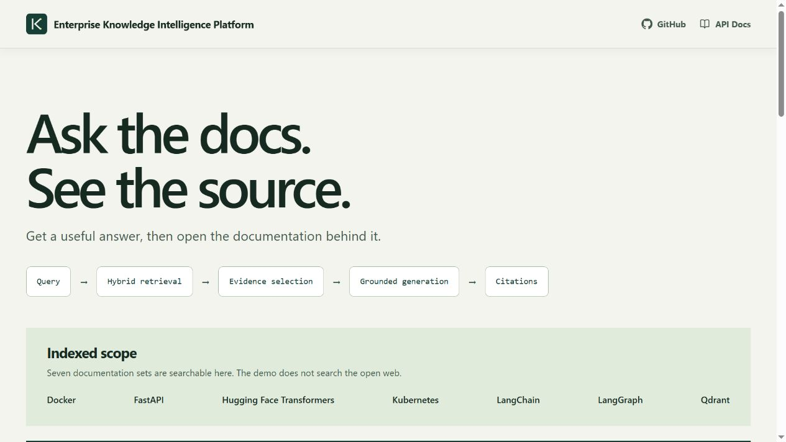
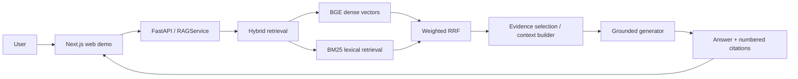

<h1 align="center">Enterprise Knowledge Intelligence Platform</h1>

<p align="center">
  Ask seven curated technical-documentation collections, get grounded answers, and open the cited sources.
</p>

<p align="center">
  
  
  
  
  <a href="https://github.com/Thazg/knowledge-intelligence-platform/actions/workflows/ci.yml"></a>
</p>

<p align="center">
  <a href="#live-demo">Live demo</a> &nbsp;|&nbsp;
  <a href="#measured-results">Results</a> &nbsp;|&nbsp;
  <a href="#how-it-works">Architecture</a> &nbsp;|&nbsp;
  <a href="docs/06_reproducibility_and_operations.md">Reproduce</a>
</p>



*Screenshot of the live web demo on 26 October 2026. The five-step workflow and seven-source indexed scope appear above the question form. The form sends new questions to the backend; the separate example answer is a labeled preview condensed from a local run.*

## Project highlights

- **Measured retrieval decisions.** On 100 manually verified questions, the frozen local v1 Weighted RRF path improved Hit@10 from the Dense baseline's **89/100 to 93/100** and MRR from **0.6644 to 0.7247**. [Retrieval report](benchmarks/retrieval/reports/retrieval_benchmark_v1.md)
- **A cloud profile with checked lexical parity.** The cloud profile kept **93/100 Hit@10** on the same evaluation set. In a 500-chunk canary, Qdrant sparse retrieval matched local BM25's exact top-10 ordering for **100/100 queries**. Its validated deployment image is **~130.5 MB**. [Cloud evaluation](benchmarks/retrieval/reports/cloud-hybrid-v1.md) | [Parity artifact](benchmarks/retrieval/reports/rank-bm25-qdrant-parity-canary-v1.json) | [Deployment characterization](docs/04_evaluation_and_benchmarks.md#10-deployment-characterization)
- **An inspectable end-to-end system.** The project includes ingestion, hybrid search, grounded generation, citation links, FastAPI serving, observability, CI, and a public Next.js interface. The [E2E review](benchmarks/e2e/reports/e2e_v1_decision.md) also records the semantic failure that prevents claiming release-ready answer quality.

## Live demo

[Open the web demo](https://enterprisekip.vercel.app/) | [API documentation](https://enterprise-kip-api.onrender.com/docs) | [API health](https://enterprise-kip-api.onrender.com/health)

The web form streams answers from the public FastAPI backend. Retrieval searches a frozen corpus of Docker, FastAPI, Hugging Face Transformers, Kubernetes, LangChain, LangGraph, and Qdrant documentation; it does not search the open web. Numbered citations point to source cards, and source links open current upstream documentation paths when available. The homepage's example answer is a **preview**, not a live response. [Web interface details](web/README.md) | [Dataset guide](data/README.md) | [Citation provenance](docs/07_citation_provenance.md)

Try: **“What is Docker BuildKit and how is it used during image builds?”** You can also ask **“What does `kubectl apply` do?”** or **“What problem does FastAPI dependency injection solve?”** The backend runs on Render Free, so an idle service may take time to wake.

The same request can be sent directly to `POST /v1/query`:

```bash
curl -X POST "https://enterprise-kip-api.onrender.com/v1/query" \
  -H "Content-Type: application/json" \
  -d '{"query":"What is Docker BuildKit and how is it used during image builds?"}'
```

The [Swagger UI](https://enterprise-kip-api.onrender.com/docs) also accepts this example through **Try it out**. The public API exposes [liveness](https://enterprise-kip-api.onrender.com/health) and [readiness](https://enterprise-kip-api.onrender.com/ready) endpoints; readiness checks its configured dependencies rather than only the web process.

## Measured results

These are **offline retrieval scores**, not answer-quality or production-latency scores. The frozen evaluation set has **100 manually verified queries**: 20 each for semantic, lexical, ambiguous, version-specific, and cross-tool questions. Hit@10 counts queries with at least one relevant document in the first ten results; MRR measures the rank of the first relevant result. Scores are fractions from 0 to 1. [Cases and protocol](benchmarks/retrieval/reports/retrieval_benchmark_v1.md)

| Retrieval configuration | Hit@10 (of 100) | MRR (0–1) | Status |
| --- | ---: | ---: | --- |
| Dense-only baseline, local | 89/100 (0.8900) | 0.6644 | Evaluated baseline |
| BM25-only baseline, local | 87/100 (0.8700) | 0.6083 | Evaluated baseline |
| Dense + BM25, Weighted RRF, local | **93/100 (0.9300)** | **0.7247** | Frozen v1 local path |
| FastEmbed BGE + exact BM25 sparse, Weighted RRF, Qdrant Cloud | **93/100 (0.9300)** | 0.7119 | Public cloud retrieval profile |
| Weighted RRF + Mixedbread v2 reranker, 20 candidates | **97/100 (0.9700)** | **0.7564** | Offline experiment; not deployed |

The deployed retrieval design is Weighted RRF. Its fuller local/cloud comparison preserves the original benchmark detail:

| Metric | Local Weighted RRF | Cloud Weighted RRF |
| --- | ---: | ---: |
| Hit@1 | 0.6200 | 0.5800 |
| Hit@3 | 0.8100 | 0.8000 |
| Hit@5 | 0.8700 | 0.9000 |
| Hit@10 | 0.9300 | 0.9300 |
| Recall@10 | 0.8392 | 0.8208 |
| nDCG@10 | 0.6788 | 0.6677 |
| MRR | 0.7247 | 0.7119 |

[Local benchmark](benchmarks/retrieval/reports/retrieval_benchmark_v1.md) | [Cloud benchmark](benchmarks/retrieval/reports/cloud-hybrid-v1.md)

### Why v1 keeps Weighted RRF

On the same 100 cases, Multi-Query reached **95/100 Hit@10** but **0.7137 MRR**, below Weighted RRF's **0.7247 MRR**. Its local steady-state retrieval mean was **619.56 ms** versus **162.28 ms** for Weighted RRF; the Multi-Query measurement used frozen rewrites and excludes live rewrite-generation time. The Mixedbread v2 reranker improved MRR to **0.7564**, Recall@10 to **0.8758**, and nDCG@10 to **0.7276**, but its mean retrieval time rose to **4,076.07 ms** with a **4,676.60 ms p95** (20-candidate pool, 100 queries, three warmups, sequential single-process measurement). Reranking is retained as an evaluated experiment, not presented as the public path. [Quality report](benchmarks/retrieval/reports/retrieval_benchmark_v1.md) | [Latency protocol](benchmarks/retrieval/reports/retrieval_latency_v1.md)

The cloud run averaged **594.76 ms per retrieval case** across 100 cases (59.48 s total). This is benchmark retrieval time, **not HTTP response time**. A separate observed warm public request took **~2.9 s backend end-to-end** and **~3.4 s client end-to-end**; these are operational observations, not a controlled latency distribution. The cloud image measured **~130.5 MB**, with **~260.5 MiB** warm RSS in Linux Docker and **~317 MiB** hosted RSS against a 512 MiB Render budget. Cold-start latency was not established by a controlled test. [Cloud run](benchmarks/retrieval/reports/cloud-hybrid-v1.md) | [Deployment characterization](docs/04_evaluation_and_benchmarks.md#10-deployment-characterization)

The exact-BM25 parity result is a **500-chunk sample from 36,199 chunks**, evaluated with 100 query texts: **100/100 exact top-10 orders**, mean local top-10 coverage **1.000000**, maximum shared score delta **0.0000024688**, and **0 mismatched queries**. It is a canary, not a full-corpus equivalence claim. [Parity artifact](benchmarks/retrieval/reports/rank-bm25-qdrant-parity-canary-v1.json)

### Generation study and independent E2E review

The local generation study used **12 manually designed development cases** across six categories to iterate on prompt behavior. Its final v3 review recorded **9 pass / 3 partial**, with no output truncation under a 384-token completion cap. On the local Ollama `qwen3:4b-instruct` run, mean retrieval was **178.00 ms**, mean generation **15,376.63 ms**, and mean end-to-end **15,554.84 ms** across those 12 cases. These are local inference-path measurements, not the public Groq service's response times, and the prompt-development cases should not be treated as an independent test set. [Generation report](benchmarks/generation/reports/generation_benchmark_v1.md)

The separate frozen E2E validation has **18 cases**. Runtime and citation-structure checks passed **18/18**; human semantic review found **12 pass, 5 partial, 1 fail**. The semantic release gate **did not pass**. This evaluated the local Ollama path, so it is not a cloud Groq answer-quality score. [E2E decision](benchmarks/e2e/reports/e2e_v1_decision.md)

Those 18 cases are a **validation set, not a training set**: three each for semantic, lexical, ambiguous, version-specific, cross-tool, and insufficient-evidence behavior. The structural evaluator checked **111/111 raw citations** with no invalid citation IDs or citation-to-source mapping errors. The human blocking failure involved an underspecified question whose answer generalized beyond the retrieved evidence. [E2E decision](benchmarks/e2e/reports/e2e_v1_decision.md)

## How it works



The frozen v1 retriever uses dense weight **0.7**, BM25 weight **0.3**, RRF `k=60`, retrieval top-`k=10`, up to **4,000** context tokens, and at most **6** sources. Adaptive routing and reranking were evaluated but are not in the deployed v1 path. [Architecture](docs/03_system_architecture.md) | [Retrieval decisions](benchmarks/retrieval/reports/retrieval_benchmark_v1.md) | [Routing decision](benchmarks/retrieval/routing/adaptive_retrieval_v1_decision.md)

The query enters `RAGService` and `RAGPipeline` through FastAPI. Dense search and BM25 retrieve candidates from the same frozen chunk corpus; Weighted Reciprocal Rank Fusion combines their ranks. The context builder selects evidence within a token budget, the generator writes an answer constrained by that evidence, and the API returns both numbered citations and source metadata. The interface lets a reader jump from a citation to its source card.

| Component | Local reference stack | Public cloud profile |
| --- | --- | --- |
| API | FastAPI | FastAPI on Render |
| Dense encoder / store | SentenceTransformers BGE / local Qdrant | FastEmbed BGE / Qdrant Cloud |
| Lexical retrieval | `rank_bm25` | Exact-BM25 query artifact + Qdrant sparse vectors |
| Generation | Ollama `qwen3:4b-instruct` | Groq `openai/gpt-oss-20b` |
| Supporting services | Docker Compose, Prometheus, Grafana | Managed Qdrant and Groq |

### Exact BM25 in the cloud

The local reference profile uses `rank_bm25.BM25Okapi`. For cloud deployment, a migration converts the same BM25 representation into Qdrant sparse vectors. At query time the cloud service loads a compact artifact with vocabulary mappings, IDF values, tokenizer settings, corpus statistics, and sparse feature indices; it does **not** load all 36,199 chunks or `rank_bm25`. The parity canary above checks ranking behavior on a bounded sample before relying on the cloud index. [Architecture](docs/03_system_architecture.md) | [Parity evidence](benchmarks/retrieval/reports/rank-bm25-qdrant-parity-canary-v1.json)

### Grounded generation and API behavior

The prompt asks the generator to answer from retrieved sources, use bracketed citations, qualify uncertainty and source disagreement, and say when evidence is insufficient. Citation structure is checked separately from semantic answer quality. Generation concurrency is bounded at **one** cloud request and the configured generation timeout is **120 seconds**. [Generation benchmark](benchmarks/generation/reports/generation_benchmark_v1.md) | [E2E review](benchmarks/e2e/reports/e2e_v1_decision.md)

The API supports `POST /v1/query` and `POST /v1/query/stream`, plus `GET /health`, `GET /ready`, `GET /metrics`, and Swagger `GET /docs`. Request validation rejects empty or overlong queries before retrieval. Operational controls include request IDs, structured logging, Prometheus metrics, dependency error normalization, timeouts, bounded generation concurrency, and admission control. The local readiness check covers the RAG service, Qdrant, and Ollama; the cloud check covers the service, Qdrant Cloud, and Groq. [Deployment runbook](docs/05_deployment_runbook.md)

The cloud package uses `docker/Dockerfile.api.cloud`, `requirements-cloud.txt`, and the versioned BM25 query artifact under `deployment/artifacts/retrieval/`. It omits PyTorch, SentenceTransformers, `rank_bm25`, and Ollama from the deployed image. The full Docker Compose stack remains a separate local reference architecture. [Deployment runbook](docs/05_deployment_runbook.md)

### From documentation to an index

The ingestion pipeline discovers source files, filters and parses them, normalizes content and metadata, applies quality checks, serializes accepted documents, tokenizes and chunks them, then builds dense and lexical indexes. The seven upstream repositories and their document/chunk counts are recorded in the [dataset guide](data/README.md); the project does not ship copies of the raw documentation. The [source-provenance note](docs/07_citation_provenance.md) explains why a live upstream URL is useful for inspection but cannot prove the exact historical indexed revision.

## Quick start

To run the **web interface** against the public backend, use Node.js **20.9+**:

```bash
git clone https://github.com/Thazg/knowledge-intelligence-platform.git
cd knowledge-intelligence-platform/web
npm ci
cp .env.example .env.local
npm run dev
```

Open [http://localhost:3000](http://localhost:3000). On PowerShell, `Copy-Item .env.example .env.local` can replace `cp`. The example environment targets the public API; no local corpus or model is needed for this web-only path. Questions submitted through the form go to that API. For an independent local backend and the full Qdrant/Ollama/Prometheus/Grafana stack, follow the [deployment runbook](docs/05_deployment_runbook.md) and [web setup](web/README.md).

The repository's main areas are:

```text
backend/       ingestion, retrieval, generation, API, services
benchmarks/    frozen cases, machine-readable outputs, decision reports
data/          dataset guide; raw and processed corpora are local
deployment/    versioned cloud retrieval artifact
docker/        local and cloud API images
docs/          architecture, evaluation, provenance, runbooks
scripts/       data, benchmark, and deployment utilities
tests/         backend tests
web/           Next.js demo and its tests
```

The root `docker-compose.yml` defines the full local reference stack: FastAPI, Qdrant, Ollama, Prometheus, and Grafana. It requires the local corpus/index and model setup described in the [deployment runbook](docs/05_deployment_runbook.md); simply starting the frontend does not reproduce that stack. The public backend instead uses Render + Qdrant Cloud + Groq.

## Testing and reproduction

The repository targets **CPython 3.13**. From the repository root, the default non-integration gate is:

```bash
python -m pip install -r requirements-dev.txt
ruff check .
pytest tests/ -q -m "not integration"
git diff --check
```

Frontend and container checks:

```bash
cd web
npm ci
npm run lint
npm test
npx tsc --noEmit
npm run build
cd ..
docker compose config --quiet
docker compose build api
docker build -f docker/Dockerfile.api.cloud -t kip-cloud:ci .
```

These commands match the [CI workflow](.github/workflows/ci.yml); the status badge above reads the live `main` workflow state. Unit tests do not require Qdrant, Ollama, downloaded ML models, or the private local corpus. Integration and retrieval-regression jobs have their own [workflows](.github/workflows/integration.yml) and [protocols](docs/06_reproducibility_and_operations.md).

Reproducing benchmark numbers requires the frozen cases, corpus/index, model versions, and profile-specific services described in [reproducibility and operations](docs/06_reproducibility_and_operations.md). The published reports record the evaluation settings and artifacts; a clean checkout alone does not recreate the Qdrant Cloud collection. Retrieval quality, local retrieval latency, generation evaluation, E2E review, and hosted HTTP observations are **different measurements** and should not be compared as one latency or accuracy score.

## Limitations

- The corpus is a **frozen English-language documentation snapshot**, not the open web or current product guidance. It contains **4,612 source documents and 36,199 chunks** across seven source groupings; coverage is uneven. Raw upstream documentation and the processed corpus are not committed here. [Dataset guide](data/README.md)
- Citation URLs open **current upstream paths**, which can drift from the indexed revision; the cards are not immutable evidence snapshots. [Provenance](docs/07_citation_provenance.md)
- The **18-case human semantic gate failed** on an ambiguous query. Retrieval accuracy and valid citation syntax do not establish answer correctness. [E2E review](benchmarks/e2e/reports/e2e_v1_decision.md)
- The best offline reranker and adaptive routing experiments are **not deployed**. Public behavior uses the simpler frozen hybrid path. [Retrieval report](benchmarks/retrieval/reports/retrieval_benchmark_v1.md)
- The public cloud profile depends on Render, Qdrant Cloud, and Groq. Free-tier wake-ups and transport variability affect user-perceived latency; the warm-request observations above are not a production SLO. [Operations](docs/06_reproducibility_and_operations.md)

## Documentation, contributing, and license

- [Dataset and source counts](data/README.md) | [Architecture](docs/03_system_architecture.md) | [Evaluation](docs/04_evaluation_and_benchmarks.md) | [Deployment](docs/05_deployment_runbook.md) | [Reproducibility](docs/06_reproducibility_and_operations.md) | [Citation provenance](docs/07_citation_provenance.md)
- [Web interface guide](web/README.md) | [Contributing](CONTRIBUTING.md) | [Security reporting](SECURITY.md)
- Original code and documentation are under the [MIT License](LICENSE). Indexed third-party documentation and dependencies retain their own licenses.
